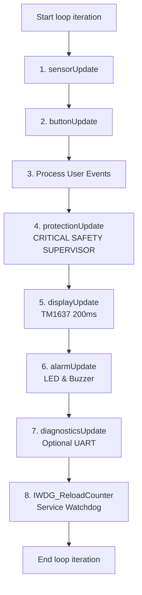

# Firmware Architecture & Software Design

**Project:** CompressorProtect  
**Target:** WCH CH32V003 (32-bit RISC-V RV32EC @ 48 MHz)  
**Document:** `docs/ARCHITECTURE.md`  

---

## 1. Architectural Philosophy

CompressorProtect is designed as a safety-critical, hard-real-time embedded supervisor for refrigeration compressors. The architectural philosophy prioritizes:

1. **Safety Supervisor Supremacy:** The protection state machine and fault shutdown logic take absolute precedence over user interface updates, display refreshing, button decoding, and debug output.
2. **Strict Non-Blocking Execution:** No function in the main loop executes blocking delays. All time intervals, delays, and debounce routines utilize asynchronous timestamps (`millis()`, `micros()`).
3. **Deterministic Actuator State:** The compressor relay defaults to de-energized (`LOW`) on power-up, hardware reset, brownout, or uninitialized GPIO state via pull-down resistors ($10\text{ k}\Omega$ at Q2 base).
4. **Hardware Resource Efficiency:** The CH32V003 offers 16 KB of Flash and 2 KB of SRAM. Complex software floating-point routines (such as soft-float `sqrt()` and double-precision printing) are eliminated in favor of pure 32-bit integer algorithms (`isqrt32`, fixed-point scaling).
5. **Fail-Safe Defaults:** If non-volatile configuration memory is uninitialized, corrupted, or exhibits checksum failure, the system falls back to conservative factory defaults and flags a configuration fault.

---

## 2. Firmware Module Decomposition

The firmware is structured into modular components:

```
firmware/
├── firmware.ino          # Main entry point: setup(), loop(), task scheduling, watchdog
├── pins.h                # Hardware pin definitions mapped directly to schematic
├── config.h              # Factory defaults, physical bounds, EEPROM map, timing constants
├── fault_codes.h         # Centralized fault code enumerations, display strings, metadata
├── system_state.h        # Finite-state machine state definitions
├── sensor_manager.h/.cpp # ADC acquisition, AC cycle integration, peak-to-peak, integer RMS
├── protection.h/.cpp     # Safety supervisor, voltage/current fault timers, rolling retry accountant
├── button_manager.h/.cpp # 3-button resistor-ladder decoder, debouncer, long-press/repeat
├── display_manager.h/.cpp# Direct-register bit-banged TM1637 driver, page cycling, settings menu
├── alarm_manager.h/.cpp  # Non-blocking LED status sequences, buzzer beeps, user mute
├── storage_manager.h/.cpp# Option-Bytes EEPROM emulation wrapper with XOR checksum
└── diagnostics.h/.cpp    # System telemetry formatting and bit-banged software UART
```

### Module Responsibilities

| Module | Primary Responsibility | Execution Cadence |
|:---|:---|:---|
| **`protection`** | Evaluates voltage limits, motor current, timing intervals, trips relay | Every `loop()` iteration |
| **`sensor_manager`** | Samples `PA2` (VAC), `PA1` (CT), `PD6` (KEY) over 20 ms AC cycles | Sub-millisecond ADC sampling |
| **`button_manager`** | Debounces resistor ladder, generates Press, Long, Repeat events | 10 ms periodic |
| **`display_manager`** | Renders 4 digits on TM1637 via direct Port C bit-banging | 200 ms periodic |
| **`alarm_manager`** | Generates non-blocking blink and beep patterns on `PD5` & `PC1` | Every `loop()` iteration |
| **`storage_manager`** | Validates checksum, updates parameters in Option Bytes | On user save / trip |
| **`diagnostics`** | Formats and outputs telemetry on software UART (if enabled) | 1000 ms periodic |

---

## 3. Main Loop Execution Sequence & Priority Hierarchy

The main execution loop follows a strict sequential hierarchy to ensure that safety evaluation occurs immediately after sensor acquisition:



### Safety Priority Invariant
A display transaction or menu navigation sequence cannot block or delay a protection shutdown:
- In `display_manager.cpp`, display transfers use a non-blocking 200 ms rate limit and fast bit-banging (~4 µs delays per clock pulse).
- If mains voltage drops below the critical sag threshold ($160\text{ V}$) or exceeds OVP ($260\text{ V}$), the relay is directly de-energized on line 4 of the execution sequence before any display code runs.

---

## 4. Protection Finite-State Machine (FSM)

The compressor operational cycle is governed by an 11-state machine:

```
[BOOT_SAFE] 
     │ (200 ms)
     ▼
[SELF_TEST] 
     │ (500 ms)
     ▼
[POWER_QUALIFY] ◄────────────────────────────────────────┐
     │ (Healthy recovery voltage for 3000 ms)           │
     ▼                                                  │
[WAIT_MIN_OFF] (300s Countdown / + Hold 3s Bypass)      │ (Voltage abnormal)
     │ (Countdown expired)                              │
     ▼                                                  │
[STARTING] (Relay ON, Inrush Blanking 1500 ms)          │
     │ (Current settles < I_LRA)                        │
     ▼                                                  │
[NORMAL_RUN] ───────────────────────────────────────────┤ (Trip OVP, UVP, OCP, LRA)
     │                                                  ▼
     │                                         [FAULT_RECOVERY]
     │                                                  │
     │                                                  ├─ (Retries < 3) ──► Returns to POWER_QUALIFY
     │                                                  ▼
     │                                            [LOCKOUT] (Retries >= 3)
     │                                                  │ (Manual Reset Button)
     │                                                  └─► Verifies V_REC ──► POWER_QUALIFY
     ▼
(10 min continuous run) ──► Resets retry counter to 0
```

### Detailed State Specifications

1. **`STATE_BOOT_SAFE`:**
   - Entry on power-on or MCU reset. Relay `PD4` is driven `LOW`. Outputs initialized. Watchdog armed.
   - Duration: $200\text{ ms}$.
2. **`STATE_SELF_TEST`:**
   - Validates Option-Bytes configuration checksum. Verifies ADC sanity.
   - Duration: $500\text{ ms}$.
3. **`STATE_POWER_QUALIFY`:**
   - Eliminates the legacy startup dead-band bug.
   - Requires AC line voltage to remain within the recovery window ($185\text{ V} \le V \le 250\text{ V}$) continuously for $3000\text{ ms}$.
4. **`STATE_WAIT_MIN_OFF`:**
   - Enforces the 300-second ($5\text{ minute}$) refrigeration pressure equalization countdown.
   - If line voltage drops below UVP trip ($175\text{ V}$) or above OVP trip ($260\text{ V}$), the state machine reverts to `STATE_POWER_QUALIFY`.
   - **Quick-Start Bypass:** Holding the PLUS (`+`) button for 3 seconds allows an authorized technician to bypass the delay if voltage is verified safe.
5. **`STATE_STARTING`:**
   - Relay `PD4` energized.
   - For the first $1500\text{ ms}$ (`STARTUP_INRUSH_WINDOW_MS`), high starting motor inrush current is tolerated.
   - If current remains above $I_{LRA}$ ($1.6\text{ A}$) for $> 2000\text{ ms}$, the motor is classified as stalled/locked-rotor (`FAULT_LOCKED_ROTOR`) and tripped.
   - If current falls below $I_{LRA}$, advances to `STATE_NORMAL_RUN`.
6. **`STATE_NORMAL_RUN`:**
   - Continuous supervision of AC voltage and compressor current.
   - Trips on sustained OVP ($> 260\text{ V}$ for $5\text{ s}$), UVP ($< 175\text{ V}$ for $5\text{ s}$), Critical Sag ($< 160\text{ V}$ immediate), Running Overload ($> 1.2\text{ A}$ for $4\text{ s}$), or Stalled Current ($> 1.6\text{ A}$ for $2\text{ s}$).
   - **Rolling Retry Reset:** Continuous running for 10 minutes clears the retry accountant.
7. **`STATE_FAULT_RECOVERY`:**
   - Relay de-energized.
   - For current faults, increments retry counter. If retries $\ge 3$, transitions to `STATE_LOCKOUT`.
   - For voltage faults, waits for voltage to re-enter recovery window ($185\text{ V} - 250\text{ V}$) for $3000\text{ ms}$, then restarts the 300-second minimum OFF timer.
8. **`STATE_LOCKOUT`:**
   - Relay locked permanently `LOW`. Display flashes `LOCK` alternating with fault code. Buzzer emits reminder chirps every 15 minutes.
   - Requires user manual reset via Menu/OK button. Reset is rejected if mains voltage is outside recovery limits.

---

## 5. Sensor Acquisition & Math Architecture

### AC Mains Voltage Processing
- Hardware: ZMPT101B voltage transformer with mid-rail DC bias on `PA2` (AIN0).
- Sampling: Sampled at $\sim 250\text{ µs}$ intervals over a $20\text{ ms}$ window ($50\text{ Hz}$ cycle, $\sim 80\text{ samples}$).
- Fast Path: Peak-to-peak amplitude $V_{pp} = V_{max} - V_{min}$. Fast RMS: $V_{fast} = V_{pp} \times 1.635$. Evaluated every 20 ms for immediate sag detection.
- Display Path: Filtered using an integer Exponential Moving Average (EMA):
  $$V_{display}[k] = \frac{7 \cdot V_{display}[k-1] + V_{fast}[k] + 4}{8}$$
  Implemented via bit-shifts (`>> 3`), avoiding float division.

### Compressor Current RMS Processing
- Hardware: ZHT103 current transformer with burden resistor $R_2 = 100\ \Omega$ and mid-rail DC bias on `PA1` (AIN1).
- Algorithm: True RMS calculated via variance:
  $$\text{Mean} = \frac{1}{N} \sum_{i=1}^N \text{ADC}_i, \quad \text{Var} = \frac{1}{N} \sum_{i=1}^N \text{ADC}_i^2 - \text{Mean}^2$$
  $$\text{RMS Counts} = \text{isqrt32}(\text{Var})$$
  $$I_{mA} = \text{RMS Counts} \times 19.69$$
- Noise Rejection: Readings below $50\text{ mA}$ are clamped to zero.

### Thermistor Subsystem (NTC1 / NTC2)
- As audited from `archive_old/CH32Version.png`, NTC1 connects to `PC3` and NTC2 connects to `PC2`.
- `PC2` and `PC3` have NO connection to the CH32V003 ADC multiplexer.
- Sensor manager returns `SENSOR_STATUS_UNAVAILABLE_NO_ADC` and sentinel $-999^\circ\text{C}$. The display shows ` -NC`. No simulated or fabricated data is generated.

---

## 6. Non-Volatile Storage Architecture (Option Bytes)

The CH32V003 lacks true internal EEPROM. Non-volatile storage is implemented using the 26-byte user-configurable Option Bytes flash page via `EEPROM.h`:

```
Byte 0:  Magic Identifier (0xC3)
Byte 1:  Structure Version (0x01)
Byte 2:  OVP Cutoff Threshold (230 - 280 V)
Byte 3:  UVP Cutoff Threshold (150 - 210 V)
Byte 4:  Running Current Limit (x10 A, e.g. 12 = 1.2 A)
Byte 5:  Stalled LRA Current Limit (x10 A, e.g. 16 = 1.6 A)
Byte 6:  Delay Timer (x10 s, e.g. 30 = 300 s)
Byte 7:  Last Recorded Fault Code
Byte 8:  XOR Checksum of Bytes 0..7
Bytes 9..25: Reserved
```

### Wear Leveling & Safety Rules
1. **Never write in loop():** Option Bytes are erased and written **only** upon explicit user confirmation in the settings menu or when recording a new safety trip.
2. **Read-Before-Write (.update):** The driver compares buffer bytes against existing flash bytes before programming to prevent unnecessary erase cycles.
3. **Checksum Verification:** On boot, if `magic != 0xC3`, `version != 0x01`, or the XOR checksum fails, conservative factory defaults are loaded automatically.

---

## 7. Independent Watchdog (IWDG) Architecture

- Clock Source: Internal Low-Speed RC Oscillator (LSI $\sim 128\text{ kHz}$).
- Prescaler: Divide-by-64 ($\sim 2000\text{ Hz}$, $0.5\text{ ms}$ tick).
- Reload Value: $3999$ ($4000 \times 0.5\text{ ms} = 2.000\text{ s}$ timeout).
- Servicing Rule: `IWDG_ReloadCounter()` is executed **exclusively as the final operation** of a completed, unblocked `loop()` pass. If any task stalls for $> 2.0\text{ s}$, the watchdog forces a hardware reset, instantly returning relay `PD4` to its default de-energized state.

