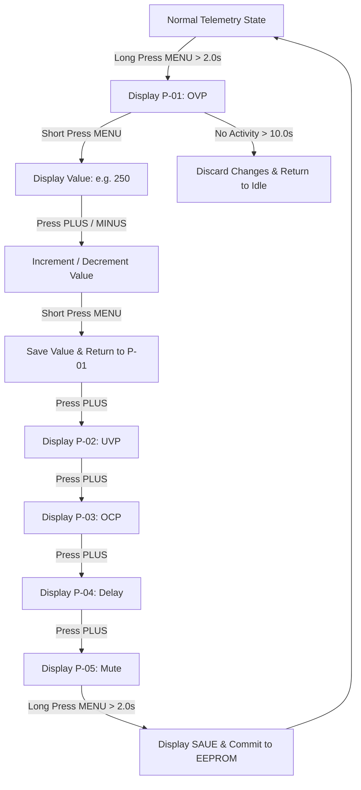

# CompressorProtect - Configuration Specification

This document details the configuration architecture, user-adjustable parameters, non-volatile memory layout, and data integrity safeguards implemented in the CH32V003 CompressorProtect firmware.

---

## 1. Architectural Overview

Configuration management is handled by `storage_manager.h` and `storage_manager.cpp`. Because the QingKe RISC-V CH32V003 microcontroller does not feature physical internal EEPROM, non-volatile parameters are stored in the **WCH Data Flash / Option Bytes Non-Volatile Memory** emulated through the standard `EEPROM.h` interface of the WCH Arduino Core.

Key characteristics:
- **Write Endurance**: High-endurance flash sector writes. Writes occur strictly upon user confirmation (`SAUE` state) in the configuration menu.
- **Integrity Verification**: 8-bit XOR checksum over all active parameter bytes.
- **Fail-Safe Fallback**: Any checksum mismatch or uninitialized memory pattern (0xFF) automatically triggers a revert to hardcoded factory defaults.
- **Memory Footprint**: Exactly 10 bytes of storage space (9 data bytes + 1 checksum byte).

---

## 2. Configurable Parameter Set (P-01 to P-05)

The interactive menu provides direct access to 5 operational parameters. These parameters are tuned using the 3-button front-panel interface and displayed on the TM1637 4-digit LED display.

| Menu Code | Parameter Name | Factory Default | Valid Range | Resolution / Step | Unit | Operational Purpose |
| :---: | :--- | :---: | :---: | :---: | :---: | :--- |
| **`P-01`** | Over-Voltage Cutoff (`ovpCutoff`) | `250` | `235` – `265` | `1` | VAC | Protects compressor winding insulation against sustained overvoltage spikes. |
| **`P-02`** | Under-Voltage Cutoff (`uvpCutoff`) | `185` | `165` – `210` | `1` | VAC | Protects motor from undervoltage stall and thermal overload. |
| **`P-03`** | Over-Current Cutoff (`ocpCutoff`) | `4.5` (45) | `1.0` – `10.0` (10–100) | `0.1` (1) | Amps | Running overcurrent threshold. Continuous draw above this value trips `E-03`. |
| **`P-04`** | Restart Delay Timer (`restartDelaySec`) | `300` | `30` – `600` | `10` | Seconds | Anti-short-cycle delay. Equalizes refrigerant pressure before motor restart. |
| **`P-05`** | Buzzer Mute Toggle (`buzzerMute`) | `0` (Unmuted) | `0` (Off) – `1` (On) | `1` | Bool | Silences audible buzzer alerts while preserving LED and visual error codes. |

---

## 3. Fixed / Factory Constants

In addition to user-adjustable parameters, the protection supervisor enforces hardcoded safety boundaries defined in `config.h`:

| Constant Identifier | Value | Unit | Description |
| :--- | :---: | :---: | :--- |
| `VOLTAGE_CRITICAL_SAG` | `160` | VAC | Severe brownout threshold triggering immediate (<100 ms) trip. |
| `VOLTAGE_HYSTERESIS` | `5` | VAC | Recovery margin required above UVP cutoff or below OVP cutoff. |
| `CURRENT_STALL_FACTOR` | `2.5` | Ratio | Dynamic stall threshold: `ocpCutoff * CURRENT_STALL_FACTOR`. |
| `CURRENT_STALL_MIN` | `12.0` | Amps | Absolute hardware floor for locked rotor amp (LRA) trip. |
| `STALL_TRIP_DELAY_MS` | `200` | ms | Ultra-fast trip delay for locked rotor fault (`E-04`). |
| `OCP_TRIP_DELAY_MS` | `3000` | ms | Sustained running overcurrent trip delay (`E-03`). |
| `RETRY_WINDOW_MS` | `600000` | ms | 10-minute rolling window for fault retry counting. |
| `MAX_FAULT_RETRY_COUNT` | `3` | Count | Number of allowable faults within window before permanent `LOCK`. |
| `LOCK_PENALTY_TIME_MS` | `1800000` | ms | 30-minute lockout penalty timer on persistent tripping. |

---

## 4. EEPROM Memory Map

Parameters are packed contiguously starting at base address `EEPROM_START_ADDR (0x00)`:

```
Address   Field Identifier            Type        Size    Encoding
-----------------------------------------------------------------------------------
0x00      ovpCutoff (Low Byte)        uint16_t    1 byte  Little-endian (e.g. 250 -> 0xFA)
0x01      ovpCutoff (High Byte)       uint16_t    1 byte  Little-endian (e.g. 250 -> 0x00)
0x02      uvpCutoff (Low Byte)        uint16_t    1 byte  Little-endian (e.g. 185 -> 0xB9)
0x03      uvpCutoff (High Byte)       uint16_t    1 byte  Little-endian (e.g. 185 -> 0x00)
0x04      ocpCutoffTenths             uint8_t     1 byte  Integer tenths (4.5 A -> 45)
0x05      restartDelaySec (Low Byte)  uint16_t    1 byte  Little-endian (300 -> 0x2C)
0x06      restartDelaySec (High Byte) uint16_t    1 byte  Little-endian (300 -> 0x01)
0x07      buzzerMute                  uint8_t     1 byte  0 = Unmuted, 1 = Muted
0x08      calibVoltage                uint8_t     1 byte  Reserved for ADC calibration trim
0x09      checksum                    uint8_t     1 byte  8-bit XOR over bytes [0x00..0x08]
-----------------------------------------------------------------------------------
Total Footprint: 10 Bytes
```

---

## 5. Data Integrity and Verification Algorithm

### 5.1 Checksum Calculation
The storage manager uses an 8-bit iterative XOR algorithm across all 9 data bytes:
$$\text{Checksum} = \bigoplus_{i=0}^{8} \text{EEPROM}[i]$$

Implementation snippet (`storage_manager.cpp`):
```cpp
uint8_t calculateChecksum(const SystemConfig* cfg) {
    const uint8_t* ptr = (const uint8_t*)cfg;
    uint8_t chk = 0xAA; // Initial seed
    for (size_t i = 0; i < sizeof(SystemConfig) - 1; i++) {
        chk ^= ptr[i];
    }
    return chk;
}
```

### 5.2 Boot Integrity Validation Sequence
1. Upon power-up, `storageInit()` reads the 10 bytes into a temporary RAM structure.
2. The calculated XOR checksum of the first 9 bytes is compared to byte 0x09.
3. Every individual parameter is validated against its permitted operational boundaries (e.g., $235 \le \text{ovpCutoff} \le 265$).
4. If either the checksum fails or any parameter violates bounds:
   - System prints diagnostic alert (if debug enabled).
   - `storageResetDefaults()` overwrites the RAM structure with factory defaults.
   - The verified factory defaults and fresh checksum are written back to EEPROM.
   - Boot sequence proceeds without system lockup.

---

## 6. Menu Adjustment Workflow



### Fast Quick-Bypass:
To assist field technicians testing units, pressing and holding **PLUS + MINUS** simultaneously for $> 3.0\,\text{s}$ during an active `DELAY` countdown reduces the remaining restart timer to 5 seconds.

