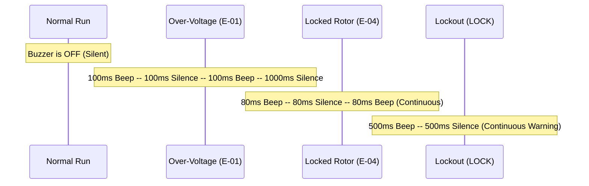

# CompressorProtect - Fault Code & Diagnostic Specification

This document provides a complete reference for all fault conditions detected by the CH32V003 CompressorProtect firmware, detailing detection thresholds, trip timings, relay actions, visual/audible alarms, and recovery procedures.

---

## 1. Fault Matrix Overview

The firmware evaluates all protection sensors continuously within the main loop. Voltage sag detection occurs at the raw ADC sampling rate (~1 kHz), while true RMS calculations and threshold evaluations occur every 100 ms.

| Code | Fault Name | Primary Cause | Detection Threshold | Trip Delay | Relay Action | Alarm Sound Pattern | Auto-Recovery Criteria |
| :---: | :--- | :--- | :--- | :---: | :---: | :--- | :--- |
| **`E-01`** | AC Over-Voltage (OVP) | Mains surge, grid regulation failure | $V_{\text{RMS}} > P\text{-}01$ (Default: 250 VAC) | 1,000 ms | Immediate Opening | Rapid Double Beep (100ms ON, 100ms OFF, 2x) | $V_{\text{RMS}} \le (P\text{-}01 - 5\,\text{VAC})$ sustained for 3.0 s |
| **`E-02`** | AC Under-Voltage (UVP) | Grid brownout, excessive line drop | $V_{\text{RMS}} < P\text{-}02$ (Default: 185 VAC) | 1,000 ms | Immediate Opening | Slow Single Beep (250ms ON, 750ms OFF) | $V_{\text{RMS}} \ge (P\text{-}02 + 5\,\text{VAC})$ sustained for 3.0 s |
| **`E-03`** | Running Over-Current (OCP) | Mechanical bind, high discharge head | $I_{\text{RMS}} > P\text{-}03$ (Default: 4.5 A) | 3,000 ms | Immediate Opening | Continuous Triple Pulse (150ms ON, 150ms OFF, 3x) | Enters Restart Delay (`dLY`) after 3.0 s |
| **`E-04`** | Locked Rotor / Stall (LRA) | Seized compressor, unequalized start | $I_{\text{RMS}} > \max(12.0\,\text{A}, 2.5 \times P\text{-}03)$ | 200 ms | Instantaneous Cutoff (<200 ms) | Urgent Continuous Stutter (80ms ON, 80ms OFF) | Enters Restart Delay (`dLY`), increments retry counter |
| **`E-05`** | Critical Voltage Sag | Severe dip, contactor bounce, blackout | $V_{\text{RMS}} < 160\,\text{VAC}$ | < 100 ms | Hardware Instant Disconnect | Urgent Rapid Beep (50ms ON, 50ms OFF) | $V_{\text{RMS}} \ge 165\,\text{VAC}$ sustained for 3.0 s |
| **`E-06`** | Condenser NTC Open | Broken cable or unpopulated thermistor | $V_{\text{NTC1}} > 3.25\,\text{V}$ | 5,000 ms | None (Uncommissioned)* | Silent / Display Alert Only | Pin reading inside valid window (0.1V - 3.2V) |
| **`E-07`** | Condenser NTC Short | Pin grounded or pinched wiring | $V_{\text{NTC1}} < 0.05\,\text{V}$ | 5,000 ms | None (Uncommissioned)* | Silent / Display Alert Only | Pin reading inside valid window (0.1V - 3.2V) |
| **`E-08`** | Cabinet NTC Open | Broken cable or unpopulated thermistor | $V_{\text{NTC2}} > 3.25\,\text{V}$ | 5,000 ms | None (Uncommissioned)* | Silent / Display Alert Only | Pin reading inside valid window (0.1V - 3.2V) |
| **`E-09`** | Cabinet NTC Short | Pin grounded or pinched wiring | $V_{\text{NTC2}} < 0.05\,\text{V}$ | 5,000 ms | None (Uncommissioned)* | Silent / Display Alert Only | Pin reading inside valid window (0.1V - 3.2V) |
| **`LOCK`** | System Lockout (Persistent Trip) | 3 consecutive electrical faults in <10 min | Counter $\ge 3$ within 10-minute window | Instantaneous | Relay Locked Open | Continuous Warning Tone (500ms ON, 500ms OFF) | Manual power-cycle OR hold **MENU** button for 5.0 s |

> \* **Notice regarding NTC Codes (`E-06` to `E-09`)**:
> On the CH32V003 microcontroller, pins `PC2` (Connector CN2) and `PC3` (Connector CN1) do not have internal analog multiplexer routing to the on-chip ADC. The firmware flags these sensors as **UNCOMMISSIONED** and safely suppresses spurious tripping, rendering ` -NC` during telemetry scrolling. Primary thermal protection is handled by the compressor motor's internal Klixon/bimetallic protector.

---

## 2. Detailed Fault Mechanisms & Rationale

### 2.1 `E-01`: AC Over-Voltage (OVP)
- **Electrical Consequence**: Sustained overvoltage increases magnetic flux saturation in the compressor stator laminations, generating excess heat, breaking down winding insulation, and stressing run capacitors.
- **De-bounce Filter**: 1,000 ms sliding window prevents false tripping from transient switching spikes.
- **Hysteresis Recovery**: Requires the line voltage to drop at least 5 VAC below $P\text{-}01$ for 3 consecutive seconds before moving to the restart delay state.

### 2.2 `E-02`: AC Under-Voltage (UVP)
- **Electrical Consequence**: Induction motors draw higher current at lower voltage to deliver equivalent mechanical torque ($P = V \cdot I \cdot \cos\phi$). If voltage drops too low, the motor decelerates past its breakdown torque, leading to high slip, rotor stall, and rapid overheating.
- **De-bounce Filter**: 1,000 ms.
- **Hysteresis Recovery**: Requires voltage to rise at least 5 VAC above $P\text{-}02$ for 3 consecutive seconds.

### 2.3 `E-03`: Running Over-Current (OCP)
- **Electrical Consequence**: Prolonged current draw exceeding nominal full load amps (FLA) indicates high head pressure, capillary tube restriction, or failing bearings.
- **Trip Delay**: 3,000 ms. Allows momentary pressure equalizations without nuisance tripping while preventing thermal overload.

### 2.4 `E-04`: Locked Rotor Amp (LRA) / Motor Stall
- **Electrical Consequence**: Starting against high differential head pressure or mechanical seizure draws locked-rotor current (typically 4x to 6x normal FLA). Stator windings will overheat within seconds.
- **Trip Delay**: $\le 200\,\text{ms}$. Instantaneous cutoff prevents trip of the main distribution breaker and saves the motor winding.

### 2.5 `E-05`: Severe Voltage Brownout Sag (<160 VAC)
- **Electrical Consequence**: At voltages below 160 VAC, control relay coils chatter, DC power rails drop out of regulation, and compressor motors immediately stall.
- **Trip Delay**: $< 100\,\text{ms}$. The system aborts operation instantly without waiting for the full 1.0 s UVP timer.

### 2.6 `LOCK`: Persistent Fault Lockout
- **Safety Mechanism**: If 3 severe electrical faults occur within a sliding 10-minute window, automatic restart attempts are halted. The display locks on `LOCK`, the yellow status LED flashes rapidly, and the buzzer emits an alarm.
- **Protection Goal**: Prevents repeated cyclic pounding on a damaged or seized compressor mechanism.
- **Reset Procedure**:
  1. Hold **MENU** button down for $> 5.0\,\text{seconds}$.
  2. Or, disconnect AC mains power for $\ge 10\,\text{seconds}$ to reset the system.

---

## 3. LED Indicator Status Codes (`PD5`)

The front-panel yellow indicator LED provides visual status without needing to decipher digit codes:

| System State | LED Output Pattern | Visual Appearance |
| :--- | :--- | :--- |
| **NORMAL (Relay ON)** | Steady ON | Solid illumination |
| **DELAY Countdown** | 1 Hz Square Wave (500ms ON / 500ms OFF) | Slow uniform flashing |
| **FAULT Active (`E-01`..`E-05`)** | 4 Hz Square Wave (125ms ON / 125ms OFF) | Fast urgent flashing |
| **LOCKOUT (`LOCK`)** | Double Flash (100ms ON, 100ms OFF, 100ms ON, 700ms OFF) | Repeating double pulse |
| **MENU Configuration** | Short Pip (50ms ON / 950ms OFF) | Periodic beacon pip |
| **Muted Alarm Active** | Tri-Pulse Sequence | Identifies silent fault |

---

## 4. Buzzer Acoustic Profiles (`PC1`)

Acoustic alerts are modulated via non-blocking software timers. All buzzer output is completely silenced when parameter `P-05` (Buzzer Mute) is set to `1`, or when the mute toggle is activated.

