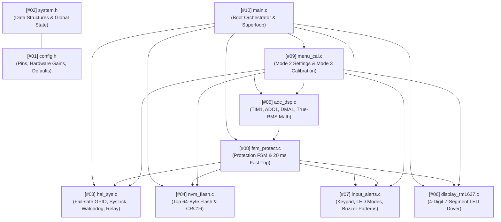
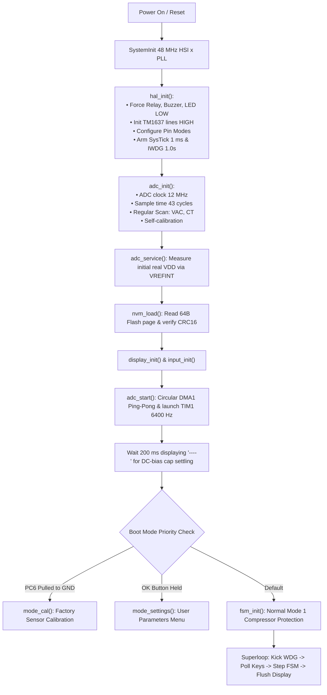
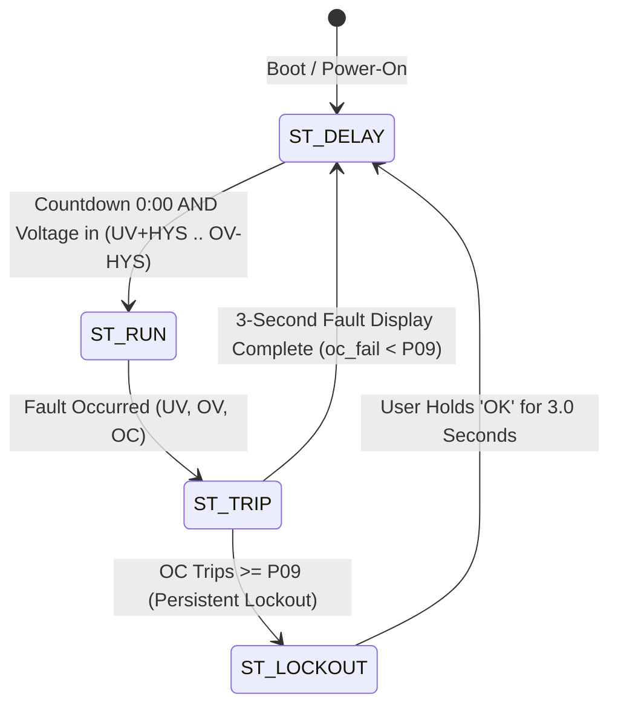

# FIRMWARE_D MASTER ENGINEERING SPECIFICATION
## Authoritative Architecture, Physical Hardware, Real-Time Math & Protection Rules

**Document:** `docs/FIRMWARE_D_MASTER_SPEC.md`  
**Status:** Living Engineering Standard  
**Target:** WCH CH32V003A4M6 (SOP16 Package, QingKe 32-bit RISC-V2A @ 48 MHz)  
**Memory:** 16 KB Flash, 2 KB SRAM  
**Framework:** Bare-Metal `ch32v003fun` on PlatformIO  
**Version:** 1.0.0 (November 2026)  

---

## 1. System Overview & Physical Hardware Map

`CompressorProtect firmware_D` is a safety-critical real-time embedded supervisor designed to protect single-phase inductive refrigeration compressor motors against destructive electrical conditions (severe undervoltage sags, overvoltage swells, startup locked-rotor stalls, sustained overload, and anti-short-cycle restart transients).

### 1.1 Verified Physical Pin Mapping (EasyEDA V1.0 SOP16 Schematic)

| MCU Port | SOP16 Pin | Peripheral Mode | Circuit Function | Electrical Connection & External Components |
|:---|:---:|:---|:---|:---|
| **`PA1`** | Pin 12 | `GPIO_CFGLR_IN_ANALOG` (ADC CH1) | Current Sense | ZHT103 Current Transformer (2000:1) with $100\ \Omega$ burden $R_2$ & $2.5\text{V}$ mid-rail bias |
| **`PA2`** | Pin 13 | `GPIO_CFGLR_IN_ANALOG` (ADC CH0) | Voltage Sense | ZMPT101B Voltage Transformer (1:1) with $820\text{ k}\Omega$ primary $R_{14}$, $100\ \Omega$ burden $R_8$ & $2.5\text{V}$ bias |
| **`PC0`** | Pin 16 | `GPIO_CFGLR_OUT_10Mhz_PP` | Buzzer Driver | Active-HIGH base drive for Q1 (S8050 NPN) driving 5V piezo buzzer |
| **`PC3`** | Pin 3 | `GPIO_CFGLR_OUT_10Mhz_PP` | TM1637 DIO | Bidirectional serial data line for TM1637 4-digit display |
| **`PC4`** | Pin 4 | `GPIO_CFGLR_OUT_10Mhz_PP` | TM1637 CLK | Push-pull serial clock line for TM1637 4-digit display |
| **`PC6`** | Pin 5 | `GPIO_CFGLR_IN_PUPD` (Pull-Up) | CAL Header | Header H1 pin 3: Pulled to GND at boot enters Factory Calibration Mode (`C-0`) |
| **`PD1`** | Pin 7 | Alternate Function (SWIO) | Debug / SWIO | WCH single-wire debug interface / SWIO UART logging |
| **`PD4`** | Pin 8 | `GPIO_CFGLR_OUT_10Mhz_PP` | Relay Driver | Active-HIGH base drive for Q2 (S8050 NPN) with $10\text{ k}\Omega$ pulldown driving 12V relay coil |
| **`PD5`** | Pin 9 | `GPIO_CFGLR_OUT_10Mhz_PP` | Status LED | Active-HIGH drive for front-panel yellow LED1 via $4.7\text{ k}\Omega$ series resistor |
| **`PD6`** | Pin 10 | `GPIO_CFGLR_IN_ANALOG` (ADC CH6) | Keypad Ladder | 3-button resistor ladder ('-', 'OK', '+') with $10\text{ k}\Omega$ pullup to $+5\text{V}$ |
| **`PC1, PC2, PC7`** | Pins 1, 2, 6 | `GPIO_CFGLR_IN_PUPD` (Pull-Up) | Unused Header | Pulled HIGH internally so inputs never float |

> [!CAUTION]
> **Hardware Discrepancy Alert:** Historical documentation and early prototypes (`docs/HARDWARE_PINMAP.md`) listed Buzzer on PC1, DIO on PC4, and CLK on PC6. **Those assignments are obsolete.** The physical EasyEDA V1.0 board routes Buzzer to **PC0**, DIO to **PC3**, and CLK to **PC4**. Never restore the obsolete pin assignments.

---

## 2. 10-Module Firmware Architecture

The implementation strictly maintains a modular 10-file architecture:



### Module Responsibilities:
1. **`config.h`:** Master hardware definitions, pin maps, timing constants, feature switches (`ENABLE_CT`, `ENABLE_NTC`), default thresholds (P01..P09), and nominal fixed-point gains.
2. **`system.h`:** Global structs `SystemConfig_t` (64 bytes aligned), `SensorData_t` (volatile real-time telemetry), enums (`FaultCode_t`, `AppMode_t`, `KeyEvent_t`, `LedMode_t`, `BeepPattern_t`), and extern function prototypes.
3. **`hal_sys.c`:** Initial output state clamping (Relay/Buzzer/LED forced LOW before driver enable), 1 ms SysTick interrupt with drift protection, 1.0-second Independent Watchdog (IWDG) kick/reload, and fast relay shadow state.
4. **`nvm_flash.c`:** Manages persistent storage in the top 64-byte Flash page (`0x08003FC0`) using CH32V003 Fast-Page Program hardware. Validates with CCITT-FALSE CRC16.
5. **`adc_dsp.c`:** Configures TIM1 TRGO @ 6400 Hz, ADC1 dual-scan sequence (PA2, PA1), circular DMA1 ping-pong buffer, single-pass variance calculation, and physical unit conversion with VREFINT-measured VDD.
6. **`display_tm1637.c`:** Bit-banged TM1637 2-wire serial driver. Implements change-detection caching (`display_flush()`) to avoid unnecessary I/O transfers.
7. **`input_alerts.c`:** Scans PD6 resistor ladder every 5 ms with 2-scan debounce, 400 ms repeat delay, 80 ms repeat cadence, and 3.0 s long-press. Drives SysTick-scheduled LED modes and non-blocking buzzer patterns.
8. **`fsm_protect.c`:** Implements the 4-state compressor protection engine (`ST_DELAY`, `ST_RUN`, `ST_TRIP`, `ST_LOCKOUT`). Evaluates undervoltage, overvoltage, startup inrush, and sustained overcurrent inside the 20 ms DMA interrupt.
9. **`menu_cal.c`:** Mode 2 two-level user settings editor (`Sett`) and Mode 3 factory calibration wizard (`C-0` zero noise, `C-V` voltage gain, `C-A` current gain).
10. **`main.c`:** Hardware bring-up sequence, power-on settling (200 ms "----"), boot mode priority selection, and cooperative non-blocking superloop execution.

---

## 3. Boot Sequence & Hardware Initialization



---

## 4. ADC Acquisition & True-RMS DSP Architecture

### 4.1 Acquisition Parameters
- **System Clock:** $48.0\text{ MHz}$
- **ADC Clock:** $12.0\text{ MHz}$ (DIV4 prescaler)
- **Sample Rate:** $6400\text{ Hz}$ per channel triggered by TIM1 TRGO Update event
- **Sample-and-Hold Duration:** 43 ADC clock cycles ($\approx 3.58\ \mu\text{s}$)
- **Nominal Mains Frequency:** $50\text{ Hz}$ ($20.0\text{ ms}$ period)
- **Samples Per AC Cycle:** Exactly $128\text{ samples}$ per channel per $20\text{ ms}$ block

### 4.2 Circular DMA Ping-Pong Buffer
- **Array:** `static volatile uint16_t dma_buf[512]` (2 channels $\times$ 128 samples $\times$ 2 half-buffers). Total size: **1024 bytes**.
- **Interrupts:**
  - `DMA_HTIF1` (Half-Transfer): Buffer index `[0..255]` is processed while index `[256..511]` is actively filled by DMA.
  - `DMA_TCIF1` (Transfer-Complete): Buffer index `[256..511]` is processed while index `[0..255]` is actively filled by DMA.
- **Interrupt Execution Priority:** DMA1 Channel 1 ISR is assigned priority `0x00` (highest in the system), executing above SysTick (`0x80`).

### 4.3 DC-Offset-Compensated Variance Mathematics
DC bias is removed in a single pass using the algebraic identity:
$$N^2 \sigma^2 = N \sum_{i=0}^{N-1} x_i^2 - \left(\sum_{i=0}^{N-1} x_i\right)^2$$

For $N = 128$, $N^2 = 16,384$. Dividing by $4$ (right shift by 2) scales variance by $4096$ ($2^{12}$), yielding **Mean-Square Power in Q12 format**:
```c
uint64_t num = (uint64_t)sumsq * 128ULL - (uint64_t)sum * sum;
uint32_t ms_q12 = (uint32_t)(num >> 2);
```

### 4.4 Square Root & Physical Scaling
1. Integer square root uses a 32-bit restoring bit-shift algorithm (`isqrt32()`, no division):
   $$\text{RMS}_{\text{Q6}} = \text{isqrt32}(\text{Power}_{\text{Q12}})$$
   Result is raw RMS in **Q6 format** ($64 \times \text{ADC RMS counts}$).
2. **Quadrature Zero-Floor Subtraction:** Subtracts uncalibrated zero-input noise floor:
   $$R = \sqrt{R_{\text{raw}}^2 - \text{Zero}_{\text{noise}}^2}$$
3. **Supply Voltage Compensation:** Uses periodic measurements of the internal $1.20\text{ V}$ bandgap ($V_{\text{REFINT}}$) to calculate actual $V_{DD}$ in millivolts:
   $$\text{mV}_{\text{pin, Q6}} = \frac{R \times V_{DD}}{1024}$$
4. **Engineering Unit Scaling:** Multiplies by hardware front-end gain (Q8) and user calibration trim (Q12), rounding to nearest integer to produce:
   - Voltage: Decivolts ($0.1\text{ V}$ units) $\implies 2200 = 220.0\text{ V}$
   - Current: Centiamps ($0.01\text{ A}$ units) $\implies 140 = 1.40\text{ A}$

---

## 5. Protection Architecture & Parameter Limits

### 5.1 Factory Default Parameters (P01..P09)

| Parameter | Code | Function | Default Value | Settable Range | Step | Description |
|:---|:---:|:---|:---:|:---:|:---:|:---|
| **P01** | `ov_v` | Over-Voltage Trip Limit | **$245\text{ V}$** | $230\text{ V} .. 270\text{ V}$ | $1\text{ V}$ | De-energizes relay if $V > \text{P01}$ |
| **P02** | `uv_v` | Under-Voltage Trip Limit | **$180\text{ V}$** | $140\text{ V} .. 210\text{ V}$ | $1\text{ V}$ | De-energizes relay if $V < \text{P02}$ |
| **P03** | `hys_v` | Voltage Hysteresis | **$10\text{ V}$** | $2\text{ V} .. 20\text{ V}$ | $1\text{ V}$ | Start window: $(\text{P02}+\text{P03}) .. (\text{P01}-\text{P03})$ |
| **P04** | `oc_ca` | Running Overcurrent Limit | **$1.40\text{ A}$** ($140\text{ cA}$) | $0.50\text{ A} .. 9.99\text{ A}$ | $0.05\text{ A}$ | Max continuous motor running current |
| **P05** | `inr_x10` | Inrush Current Multiplier | **$2.5\times$** ($25$) | $1.5\times .. 5.0\times$ | $0.1\times$ | Startup limit = $\text{P04} \times \text{P05}$ ($3.50\text{ A}$) |
| **P06** | `tin_ds` | Inrush Grace Window | **$1.5\text{ s}$** ($15\text{ ds}$) | $0.5\text{ s} .. 5.0\text{ s}$ | $0.1\text{ s}$ | Startup blanking window duration |
| **P07** | `toc_ds` | Running Overcurrent Delay | **$0.5\text{ s}$** ($5\text{ ds}$) | $0.1\text{ s} .. 5.0\text{ s}$ | $0.1\text{ s}$ | Permitted continuous overload before trip |
| **P08** | `delay_min` | Anti-Short-Cycle Restart | **$5\text{ min}$** | $1\text{ min} .. 10\text{ min}$ | $1\text{ min}$ | Pressure equalization delay after power-on/trip |
| **P09** | `ret_cnt` | Consecutive Overcurrent Trips | **$3\text{ trips}$** | $1 .. 5$ | $1$ | Trips allowed before permanent `LOC3` lockout |

### 5.2 Operating States & Transitions



1. **`ST_DELAY` (Startup Countdown):** Relay OFF. LED blinks at 1 Hz (`LED_SLOW`). Display shows countdown (`05:00`). If voltage drifts outside $(\text{UV}+\text{HYS}) .. (\text{OV}-\text{HYS})$, timer holds at full 5 minutes and alternates fault code (`E-UV` / `E-OV`) with time.
2. **`ST_RUN` (Normal Protection):** Relay ON. LED solid ON (`LED_ON`). Display alternates Voltage (` 220`) and Current (`A140`) every 2 seconds. Evaluates faults every 20 ms. If healthy for 3 continuous minutes (`HEALTHY_CLEAR_MS`), clears persistent OC failure count.
3. **`ST_TRIP` (Fault Display):** Relay de-energized immediately in ISR. Buzzer sounds 3 rapid alert beeps (`BEEP_ALERT`). LED flashes rapidly at 4 Hz (`LED_FAST`). Display latches fault text (`E-UV`, `E-OV`, `E-OC`) for 3.0 seconds (`TRIP_SHOW_MS`). If OC trip, increments persistent `oc_fail` counter in Flash.
4. **`ST_LOCKOUT` (Persistent Lockout `LOC3`):** Relay locked OFF. LED double-flashes every 1 s (`LED_DOUBLE`). Display displays `LOC3`. Buzzer sounds two 400 ms lock tones (`BEEP_LOCK`) every 30 seconds. Cleared only by holding the 'OK' button continuously for 3.0 seconds.

---

## 6. Non-Volatile Storage (NVM) & Flash Layout

- **Location:** CH32V003 top 64-byte Flash page at address **`0x08003FC0`** (last page of 16 KB Flash).
- **Structure Size:** Exactly 64 bytes (`_Static_assert(sizeof(SystemConfig_t) == 64)`).
- **Integrity Check:** CCITT-FALSE CRC16 ($x^{16} + x^{12} + x^5 + 1$, initial `0xFFFF`) calculated over the first 62 bytes.
- **Hardware Programming:** Uses CH32V003 Fast-Page Program hardware (`FLASH->CTLR |= FL_FTPG`). Writes 16 $\times$ 32-bit words into internal buffer, then commits page in a single operation.
- **Interrupt Protection:** DMA1 interrupts are suspended (`NVIC_DisableIRQ`) during Flash programming to prevent bus stalls from corrupting real-time sampling.

---

## 7. Resource Budget & Compilation Metrics

### 7.1 Verified PlatformIO Build Metrics (GCC 12.2.0 RISC-V)
- **Target:** `genericCH32V003A4M6`
- **Compiler Flags:** `-Os -ffunction-sections -fdata-sections -Wl,--gc-sections`
- **Flash ROM Utilization:** **$8,928\text{ bytes}$ / $16,384\text{ bytes}$ ($54.5\%$)** (7,456 bytes free)
- **SRAM Utilization:** **$1,308\text{ bytes}$ / $2,048\text{ bytes}$ ($63.9\%$)** (740 bytes free)

### 7.2 Static SRAM Allocation Breakdown
- DMA Ping-Pong Buffer (`dma_buf`): $1024\text{ bytes}$ ($50.0\%$ of total MCU RAM)
- Active RAM Config (`g_cfg`): $64\text{ bytes}$
- Real-Time Sensor Telemetry (`g_sens`): $24\text{ bytes}$
- Display, Keypad, FSM, and SysTick Globals: $80\text{ bytes}$
- C Runtime, ISR vectors, and initialized data: $116\text{ bytes}$
- **Stack Headroom:** $\mathbf{740\text{ bytes}}$ free space for call stack and interrupt frames.

---

## 8. Known Limitations & Outstanding Hardware Validation

1. **Analog Dynamic Range Deficiency:** At 220 V AC, the ZMPT101B ($820\text{ k}\Omega / 100\ \Omega$) yields only $\approx 5.5\text{ ADC counts RMS}$. The delta between nominal 220 V and the 180 V undervoltage limit is only **$1.0\text{ ADC count}$**. Hardware resistor retuning is mandatory for genuine precision.
2. **Current Transformer Verification:** The 2000:1 ratio for ZHT103 must be confirmed on bench hardware with a precision current source.
3. **Four-Block Pre-Smoothing Lag:** In current code, `vac_raw_dv` inherits an 80 ms moving average before protection logic sees it. Decoupling fast protection from display smoothing is scheduled for the upcoming DSP upgrade.
