# System Flowcharts & Visual Architecture

**Project:** CompressorProtect  
**Target:** WCH CH32V003 (32-bit RISC-V RV32EC @ 48 MHz)  
**Document:** `docs/FLOWCHARTS.md`  

---

## 1. Overall System Architecture

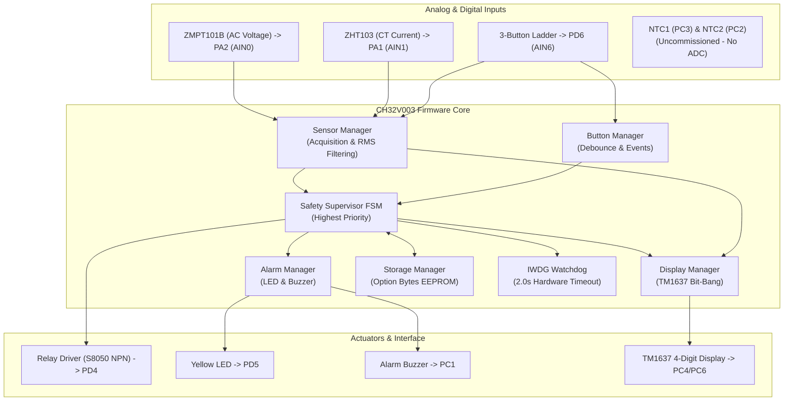

---

## 2. Power-On Initialization Sequence

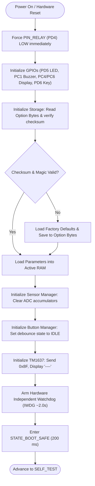

---

## 3. Sensor Self-Test

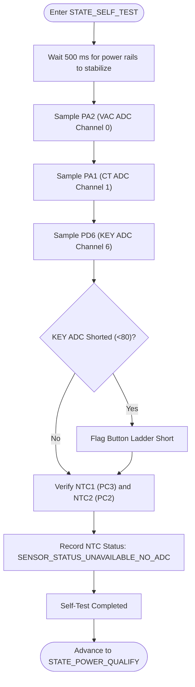

---

## 4. Voltage Qualification

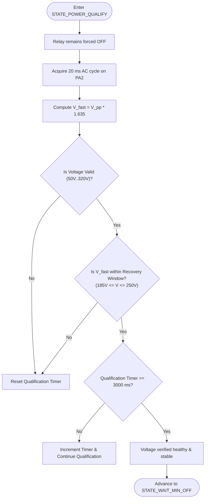

---

## 5. Compressor Startup Sequence

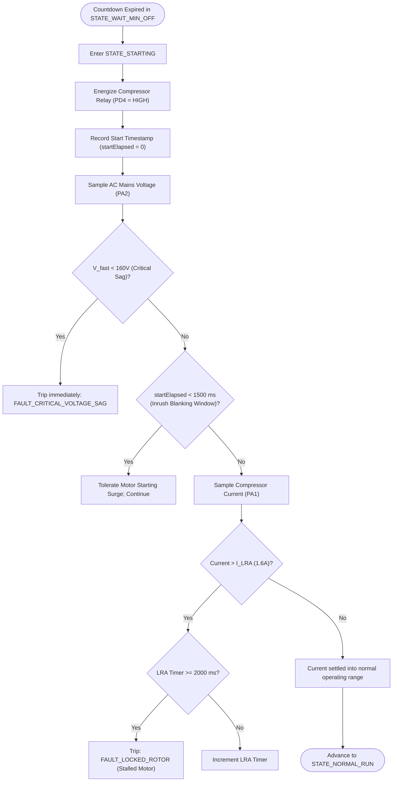

---

## 6. Normal Operation Loop

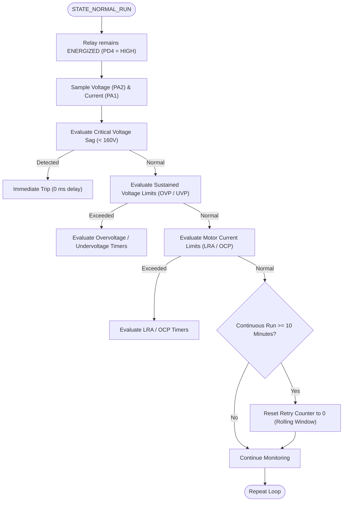

---

## 7. Voltage Protection Flow

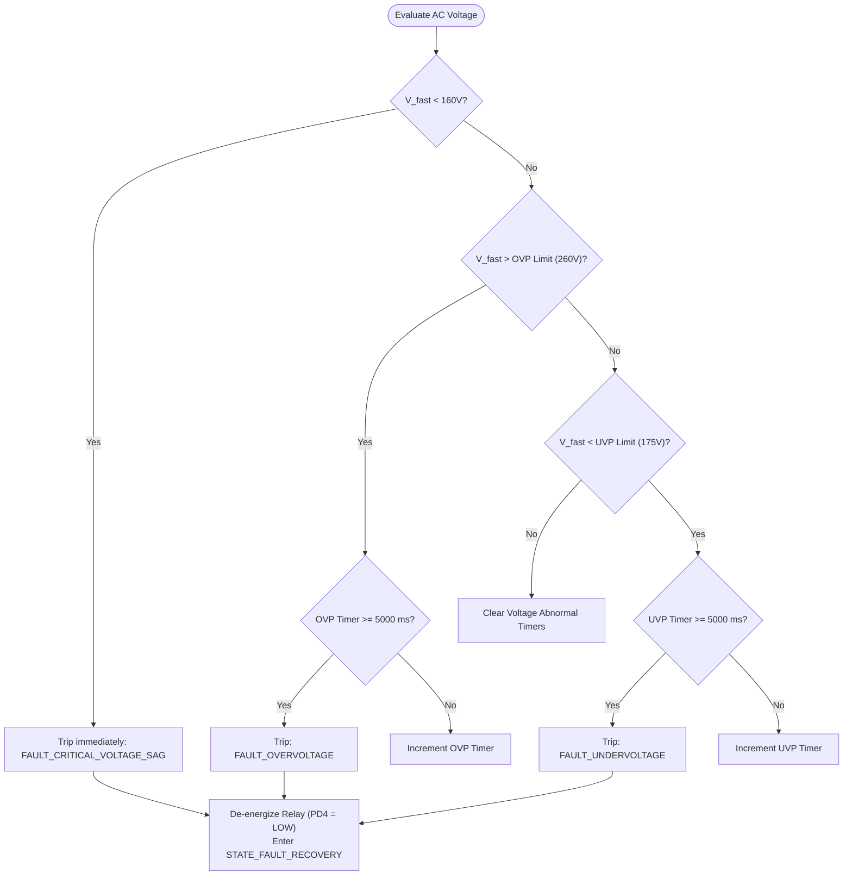

---

## 8. Current Protection Flow

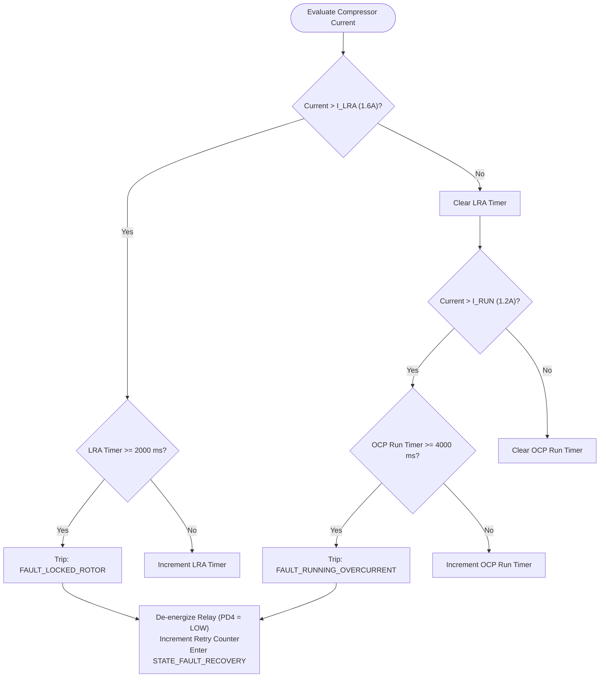

---

## 9. Compressor Thermal Protection Logic (Hardware Constrained)

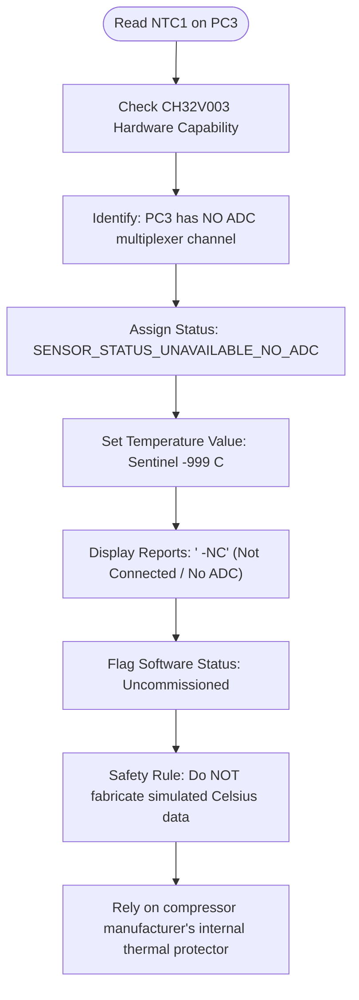

---

## 10. Refrigeration-Line Diagnostic Processing (Hardware Constrained)

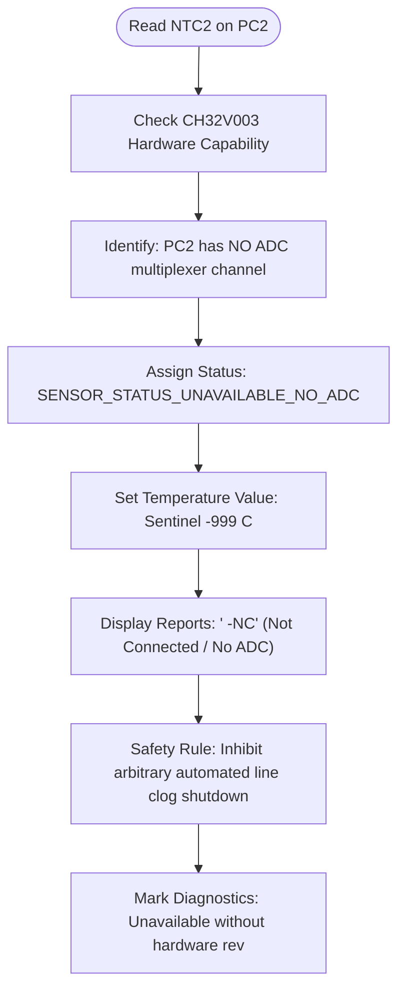

---

## 11. Fault Recovery Flow

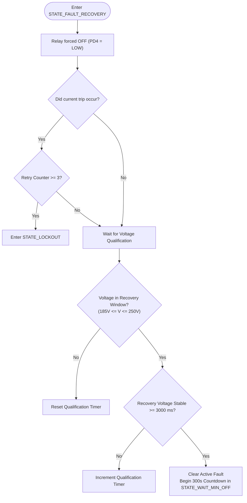

---

## 12. Lockout and Manual Reset Flow

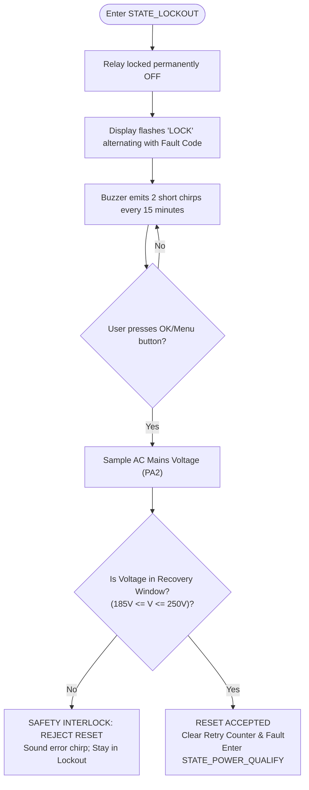

---

## 13. Three-Button Navigation Flow

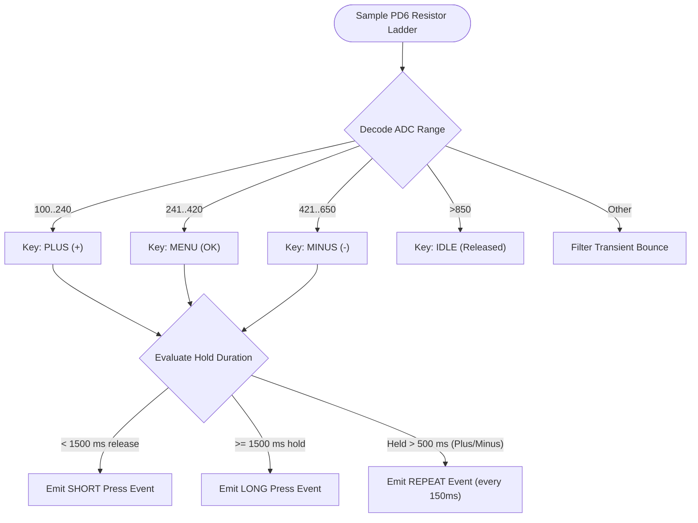

---

## 14. Parameter Editing & Option Bytes Validation Flow

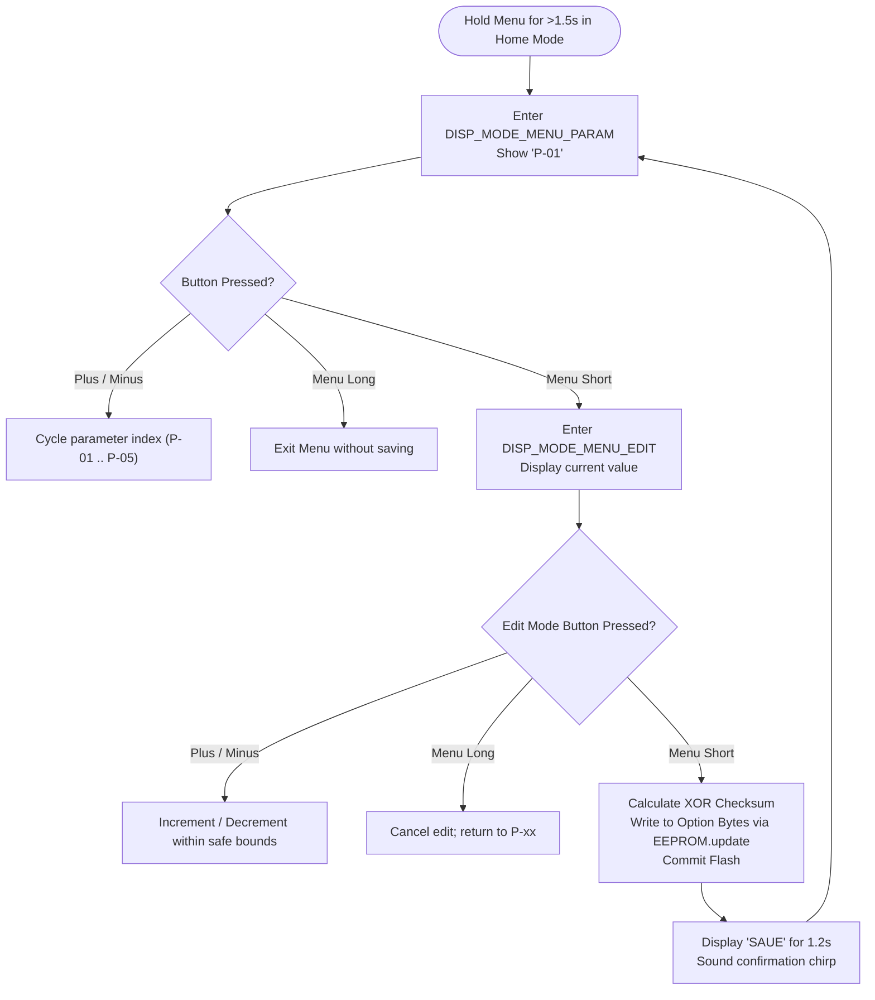

---

## 15. Status LED & Alarm Buzzer Behavior

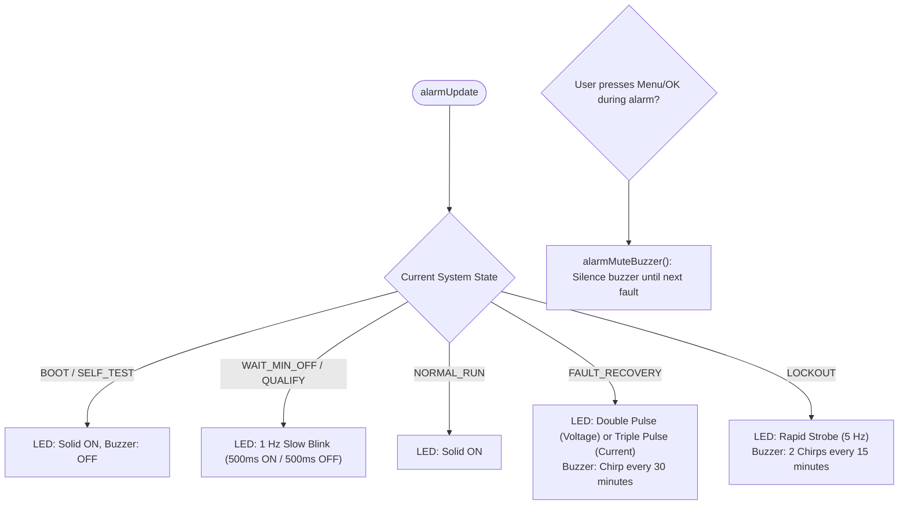

---

## 16. Watchdog Servicing & Stall Recovery

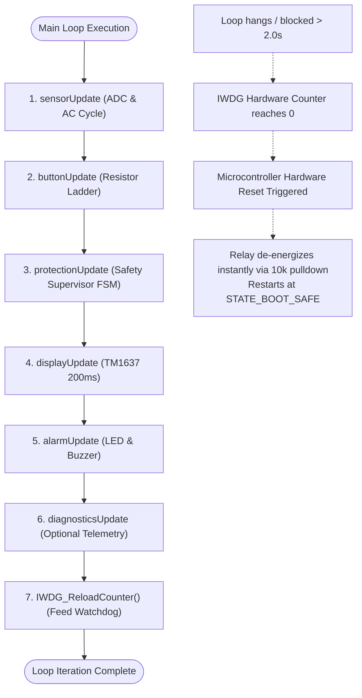

