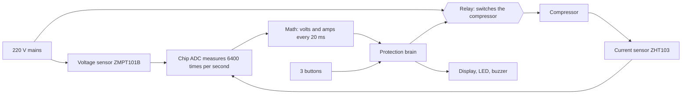
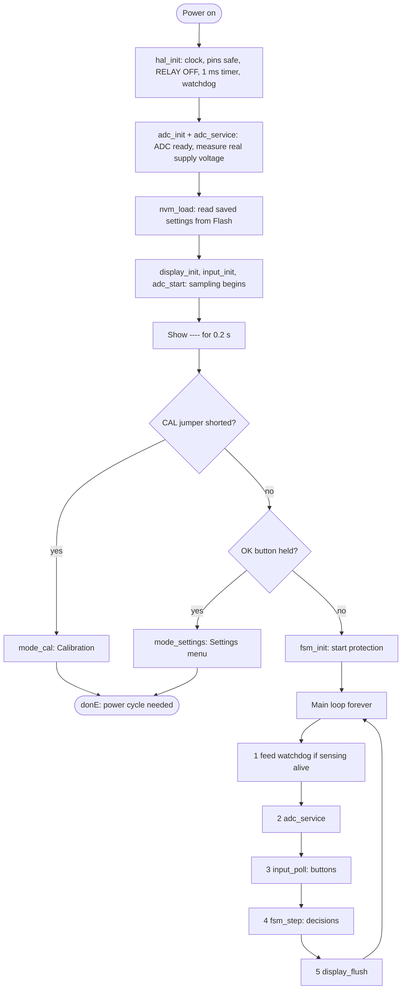
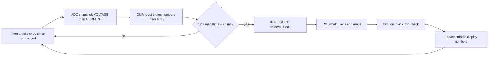
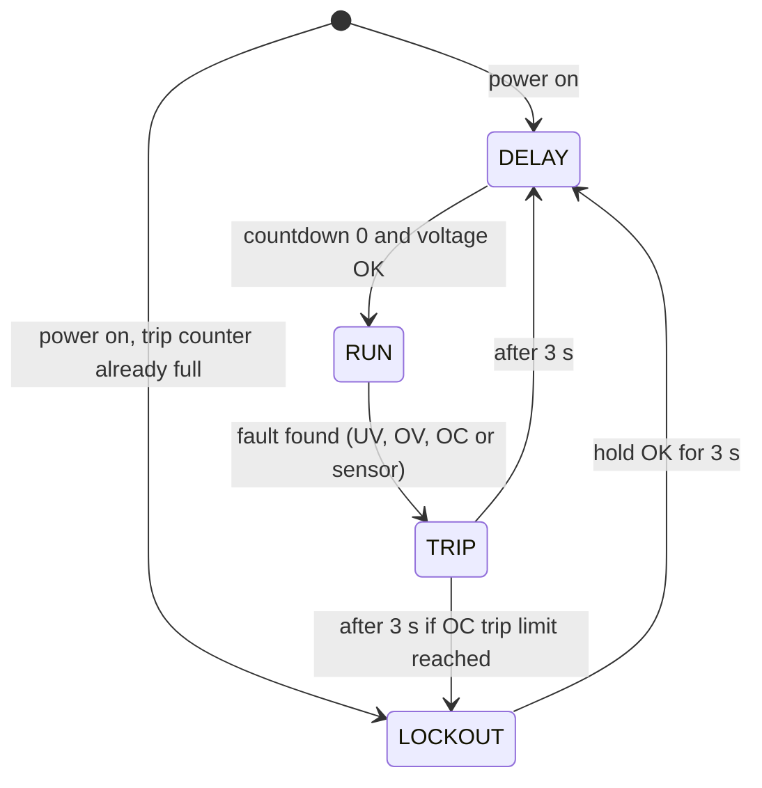
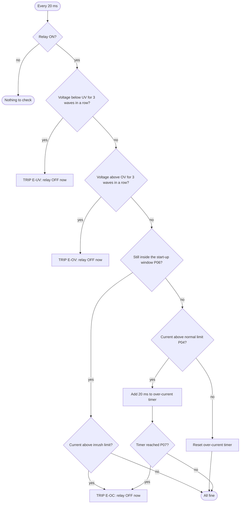
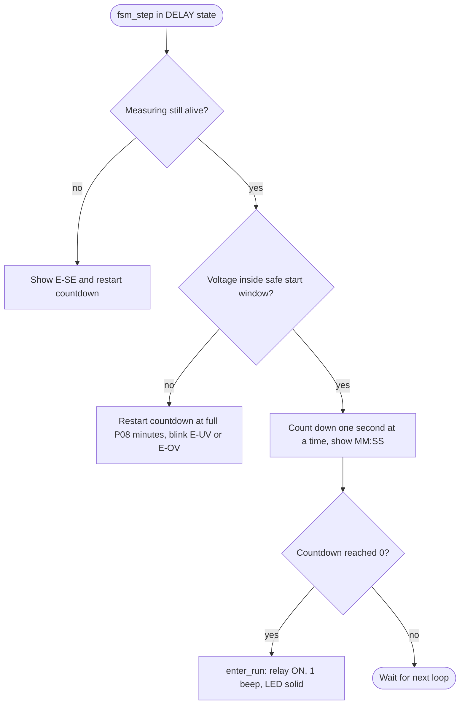
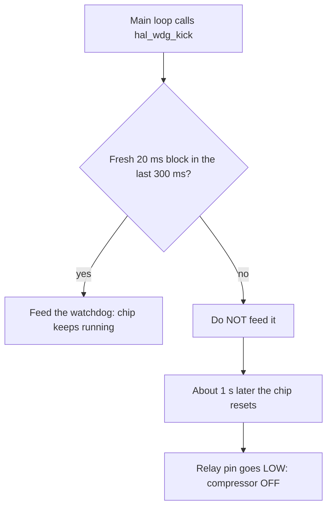
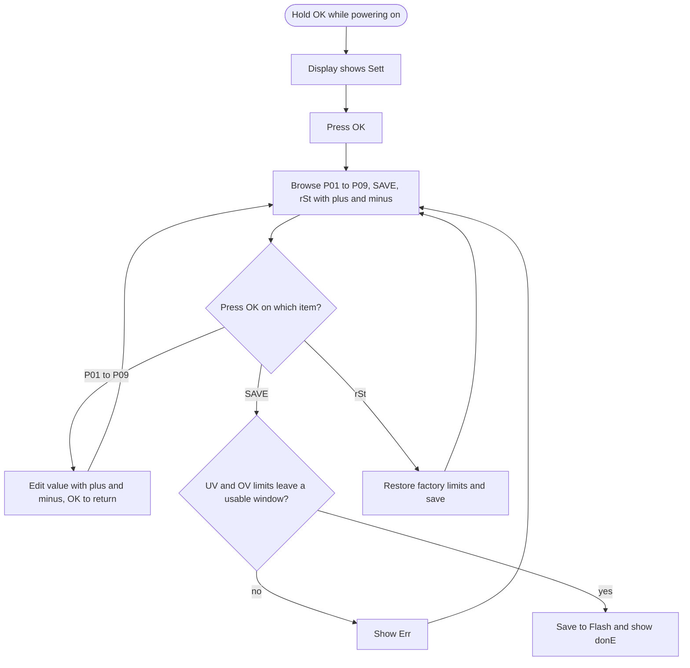
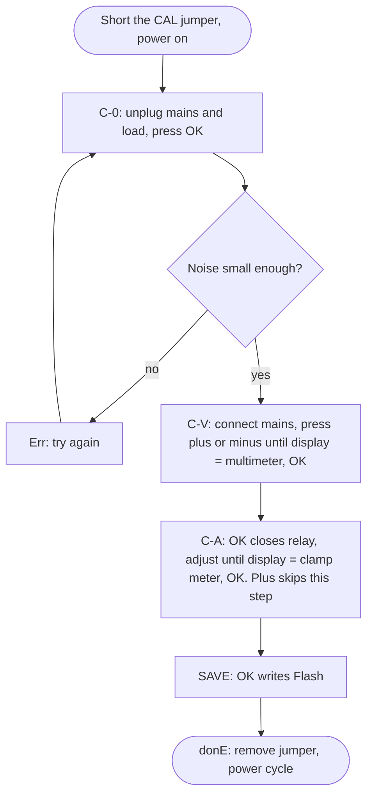

# How the Compressor Protector works

A plain-English guide. Diagrams render on GitHub and in VS Code (Markdown Preview Mermaid Support extension).

**One sentence:** the chip watches the mains voltage and the compressor current; if anything is unsafe it opens the relay, then waits several minutes before allowing a restart.

## 1. The big picture

The chip sits between the mains and the compressor. It measures voltage and current many times per second, and decides whether the relay may stay closed.

## 2. What happens at power-on (main.c)

Everything starts in main(). It prepares the hardware (always with the relay OFF), picks a mode, then repeats five small jobs forever. The urgent work happens in interrupts, not in this loop.

## 3. How a measurement is made (adc_dsp.c)

No program code is needed to take samples: a timer, the ADC and a DMA “robot” do it by themselves. Only once per 20 ms (one wave of 50 Hz mains) does an interrupt wake the CPU to do the math.

## 4. The protection brain: 4 states (fsm_protect.c)

The protector is always in exactly one of four situations. Events (timers, faults, long button press) move it to another one.

## 5. The 20 ms safety check (fsm_on_block)

This runs inside the 20 ms interrupt, only while the relay is ON. Voltage must be bad for 3 waves (60 ms) in a row, so one electrical spike cannot cut the compressor. Right after switch-on the current limit is higher because motors draw a surge (inrush).

## 6. The waiting countdown (DELAY state)

After power-on and after every trip the relay stays OFF for P08 minutes. The timer only runs while the mains voltage is in the safe window. This protects the compressor from quick restarts.

## 7. The watchdog safety net

The main loop feeds the watchdog only if measuring is still alive. This stops a frozen ADC from leaving the relay ON with no protection.

## 8. Settings menu (hold OK at power-on)

Change the limits P01 to P09. Each one has a minimum and maximum so you cannot enter a dangerous value.

## 9. Calibration (short CAL jumper at power-on)

Do this once per board with a multimeter so the display shows true volts and amps.

## Display messages cheat sheet
| Display | Meaning |
|---|---|
| `----` | Starting up, no measurement yet |
| `05:00` | Waiting countdown (minutes:seconds) before the relay may switch on |
| `220` | Running: mains voltage in volts |
| `A140` | Running: compressor current 1.40 A (alternates with voltage every 2 s) |
| `E-UV` / `E-OV` | Under-voltage / over-voltage |
| `E-OC` | Over-current (overload or stalled compressor) |
| `E-SE` | Sensor error: measuring stopped, relay forced OFF |
| `LOC3` | Locked out after too many over-current trips: hold OK 3 s to unlock |
| `Sett`, `P01`..`P09`, `SAVE`, `rSt`, `donE`, `Err` | Settings menu |
| `C-0`, `C-V`, `C-A` | Calibration steps |

## LED and buzzer
| LED | Meaning | Buzzer | Meaning |
|---|---|---|---|
| Solid | Relay ON | 1 beep | Relay switched on, or saved |
| Slow blink (1 Hz) | Countdown or Settings | 3 short beeps | Fault trip |
| Fast blink (4 Hz) | Fault shown, or Calibration | 2 long beeps | Lockout (repeats every 30 s) |
| Double flash | Lockout | | |

## Settings (defaults)
| Code | Meaning | Default | Range |
|---|---|---|---|
| P01 | Over-voltage trip | 245 V | 230-270 |
| P02 | Under-voltage trip | 180 V | 140-210 |
| P03 | Start hysteresis | 10 V | 2-20 |
| P04 | Over-current limit | 1.40 A | 0.50-9.99 |
| P05 | Inrush multiplier | x2.5 | x1.5-x5.0 |
| P06 | Inrush window | 1.5 s | 0.5-5.0 |
| P07 | Over-current delay | 0.5 s | 0.1-5.0 |
| P08 | Restart delay | 5 min | 1-10 |
| P09 | OC trips before lockout | 3 | 1-5 |

## Glossary
- **ADC**: turns a voltage on a pin into a number 0..1023.
- **RMS**: the "effective" size of an AC wave (220 V RMS heats like 220 V DC).
- **Interrupt**: an automatic pause of the main loop to run an urgent short function.
- **DMA**: a helper inside the chip that moves data without using the CPU.
- **Watchdog**: a countdown that resets the chip if the program stops feeding it.
- **Flash**: memory that keeps data without power (our settings notebook).
- **CRC**: a checksum that detects damaged data.
- **Q6 / Q8 / Q12**: fixed-point numbers, value multiplied by 64 / 256 / 4096 so the chip can avoid decimals.
- **Hysteresis**: a gap between "trip" and "start" levels so the relay does not chatter.
- **Inrush**: the big current surge when a motor starts.
